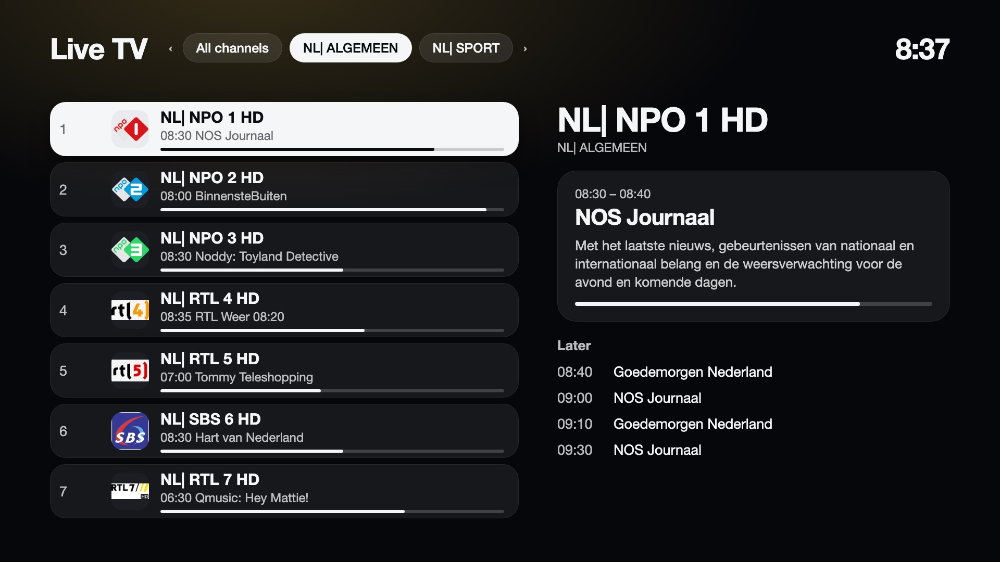
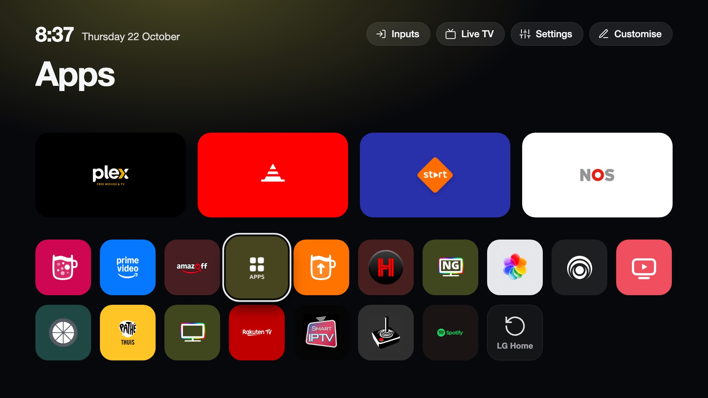
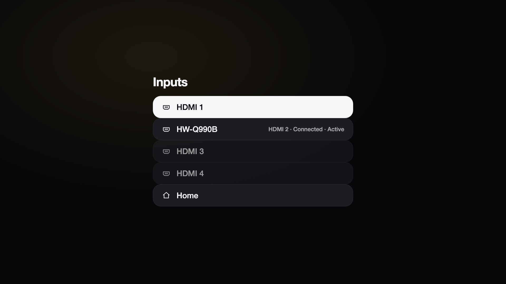
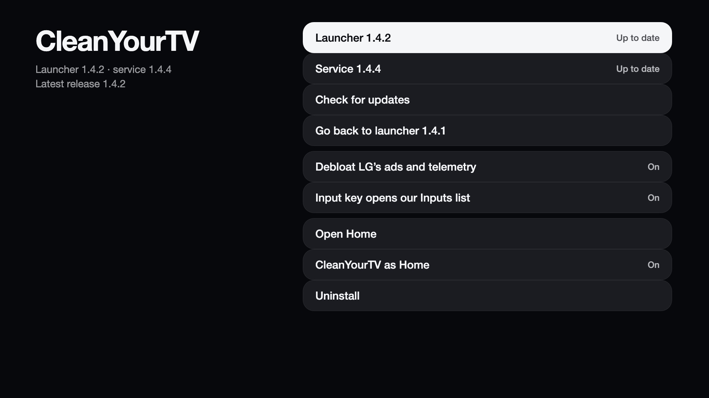

# CleanYourTV for LG webOS

A clean home screen for rooted LG webOS TVs, with an optional debloat of LG's ads and telemetry.

- **Launcher:** replaces LG's Home with a dock of four apps, a top shelf with the focused app's name and an ambient
  glow taken from its icon, an app grid, an Inputs picker, a Settings shortcut and a clock.
- **Live TV:** plays your own M3U playlist, with channel list, programme guide and number entry.
- **Picture notifications:** shows a card with a photo on top of any app, triggered from your network.
- **Input key:** the remote's Input button opens a fast Inputs list over the running app instead of LG's picker.
- **Manager app:** installs and updates the launcher and the service from GitHub releases (checked by SHA-256, with
  rollback), switches the options and switches between LG's Home and ours.
- **Debloat:** stops LG's ad and telemetry services and blocks a few ad servers.

Everything runs from RAM at boot. Nothing under `/usr`, `/etc` or the firmware is modified, and a reboot without
the boot scripts brings LG's Home back. Tested on an LG OLED65G26LA (G2) with webOS 25; other rooted models are
untested.

<p align="center"></p>

<p align="center"></p>

<table>
<tr>
<td></td>
<td></td>
</tr>
<tr>
<td></td>
<td></td>
</tr>
<tr>
<td></td>
<td></td>
</tr>
</table>

## Requirements

- An LG webOS TV that is already rooted with the [Homebrew Channel](https://webosbrew.org) ([rootmy.tv](https://rootmy.tv)).
- SSH access as `root` (`ssh root@<tv-ip>`) for the install script, or any other way to install an `.ipk`.
- Internet access on the TV and the tools webOS ships: `curl`, `tar`, `python3`, `node`.
- Tested on one TV only: LG OLED65G26LA, webOS 25. The setup checks that LG's Home app is the flutter or web kind it was
  written for. On other firmware it stops with "LG's Home app looks different" and shows what it found; **Set up
  anyway** (or `bootstrap.sh install --force`) tries it regardless. **Share log** in the manager app gives a report you can paste into the issue. The original is backed up, and if the new Home
  does not come up the setup removes the boot scripts and restarts the TV with LG's Home. If you try this on another
  model, please open an issue with the output of `cat /usr/palm/applications/com.webos.app.home/appinfo.json`.

## Install

CleanYourTV is one package, `com.cleanyourtv.manager_<version>_all.ipk`, from the
[Releases](https://github.com/lasharor/cleanyourtv-WebOS/releases) page. It contains the manager app, the Inputs
picker and notification overlay apps, the service, the launcher and the bundled inputhook (see
[`THIRD-PARTY.md`](THIRD-PARTY.md)). Installing it only adds the apps; nothing on the TV changes until you run the
setup in the manager app.

**1. Install the manager app.** Run from your computer, with your TV's IP address. The script downloads the latest
release package, checks its SHA-256 and installs it:

```sh
ssh root@192.168.1.50 'curl -fsSL https://raw.githubusercontent.com/lasharor/cleanyourtv-WebOS/main/install.sh | sh'
```

Or download the `.ipk` yourself and install it with the Homebrew Channel's tools or `ares-install`.

**2. Set up, on the TV.** Open **CleanYourTV** in the app list. Choose the options, then **Set up now**:

| Option | Default |
|---|---|
| Debloat LG's ads and telemetry | on |
| Take over the Input key | on |

The setup runs through the Homebrew Channel's root service and takes about a minute; the screen blinks once while
LG's system app manager restarts. It does the following:

1. Checks for root and a rooted webOS TV, and saves the original state (stock Home `appinfo.json`, `/etc/hosts`,
   process and service lists) in `/media/developer/cleanyourtv/backup`.
2. Copies the service files, the launcher and the inputhook to `/media/developer/cleanyourtv`.
3. Adds boot scripts to `/var/lib/webosbrew/init.d/`: `10-cleanyourtv-home` starts the service and mounts the
   launcher over LG's Home; `15-cleanyourtv-debloat` runs the debloat a minute after boot.
4. Applies everything, registers the overlay apps and checks that the new Home is registered and the service
   answers with the matching version. If that fails within two minutes, it restores LG's Home and removes the boot
   scripts. The setup's log is `/tmp/cytv-bootstrap.log` on the TV.

Over SSH the same setup is `sh /media/developer/apps/usr/palm/services/com.cleanyourtv.manager.service/bootstrap.sh install`
(options `--no-debloat`, `--no-input-key`, `--no-start`, `--no-verify`, `--force`).

**Update:** open the **CleanYourTV** app. Before the setup (or when the setup failed) the service is not running; the app
then checks for a newer package by itself and shows **Update to x.y.z**, which downloads, checks and installs it through
the root service without the service. After the setup: It checks the latest GitHub release; the launcher and the service update
separately. A launcher update is downloaded, checked against the release's `.sha256` file, installed and started;
if the new launcher does not report in within 40 seconds, the previous one is put back. A service update installs the
new package and restarts the service; if the new service does not come up, the previous files are restored. The
manager can also go back to the previous launcher version. Settings and usage history are kept. Running the install script again on a set-up TV also updates the service.

**Uninstall:** **Uninstall** in the manager app, or `sh /media/developer/cleanyourtv/uninstall.sh` (`--keep-config`
keeps settings and usage history). It removes the apps, the boot scripts and our Input-key bind, then **restarts the
TV**, which brings LG's Home back. (The hook disappears with the restart.)

## The manager app

**CleanYourTV** in the app list:

| Row | What it does |
|---|---|
| Launcher, Service | Show the installed version and offer an update when the latest release is newer. |
| Check for updates | Asks GitHub for the latest release. |
| Share log | Shows a QR code. Scan it with a phone on the same Wi-Fi to open a page with a report (versions, TV model and firmware, LG's Home app type, the setup log, the service log) and a **Copy** button, for bug reports. Addresses, MAC addresses and URL paths are masked. The page closes after ten minutes. It works even when the setup failed. |
| Go back to launcher x.y.z | Appears after a launcher update; swaps the previous version back in. |
| Debloat | Turns the debloat on or off (boot script and running state). |
| Input key | Turns the Input-key takeover on or off. |
| Open the launcher | Opens Home. |
| CleanYourTV as Home | Switch: choose LG's Home or ours. Either way the TV restarts (asks first). |
| Uninstall | Removes everything (asks first). |

## Using the launcher

| Action | How |
|---|---|
| Open an app | OK |
| App options (dock, hide) | Hold OK on an app |
| Remove a top button | Hold OK on it |
| Customise | The Customise button, top right |
| Open Live TV | The Live TV button or tile |
| Switch input | The Inputs button |

**Customise** holds the top buttons (remove, or add Inputs, Live TV, Settings or any app), hidden apps, the app
order, the clock format and a reset.

- **Dock:** up to four apps; add, replace, move or remove them from an app's options menu.
- **App order:** the grid sorts by how often you use each app, most used first (or A to Z). Usage is counted when an
  app stays in the foreground for a few seconds, however it was started; older use counts for less (half-life 30
  days).
- **Inputs:** lists each HDMI port with the name of the connected device and whether it is connected or the active
  source.
  Launching `com.webos.app.home` with the parameter `{"inputs": true}` opens this list directly.
- **Language and clock:** menus follow the TV's language (English, Dutch, German, French and Spanish are
  translated). The clock uses the 24- or 12-hour format of that language unless you choose one in Customise.

Settings are stored in `/media/developer/cleanyourtv/config.json` and survive reboots and reinstalls. The file
holds `dock` (up to four app ids), `topbar` (buttons with `label`, `icon` and `app` or `action`), `hidden` and
`sort` (`usage` or `alpha`). `config.example.json` shows the format.

## Live TV

Plays an IPTV playlist (M3U) from your own provider or media server. It does not use LG's tuner or channel list.

**Setup (first use):** the screen shows an address and a 4-digit code. Open the address on a phone or computer on
the same network, enter the code and paste the playlist address (and the XMLTV guide address if the playlist does
not name one). The page closes after saving or after ten minutes. From a shell on the TV:

```sh
curl -X POST localhost:8765/api/live/settings -d '{"playlistUrl":"http://...","epgUrl":"http://..."}'
```

**Remote**

| Key | Action |
|---|---|
| Up / Down, CH+ / CH- | Next / previous channel |
| Digits | Jump to a channel number (numbers follow the playlist order, 1 to N) |
| OK | Open the guide |
| Info, Left / Right | Show the channel banner (now and next) |
| Back, Home | Return to the launcher and stop the picture |

**Guide screen (OK):** group tabs across the top (Left / Right), the channels as rows with logo, what is on now and a
progress bar, and a panel for the selected channel with the current programme (time, title, description) and what
follows.

**Notes**

- The TV's own player plays HLS (`.m3u8`). For `…/live/<user>/<pass>/<id>.ts` links the launcher requests the
  `.m3u8` version first. Plain MPEG-TS streams that are not HLS may not play.
- The XMLTV guide is downloaded in the background (compressed) and refreshed twice a day. The next 36 hours are kept.
  Programmes titled "No Data" are ignored.
- No recording, pause or favourites.
- The playlist address is stored only on the TV, in `/media/developer/cleanyourtv/live/`. `curl -X POST
  localhost:8765/api/live/reset` clears it; the uninstaller removes it.

## Input key

The remote's Input button opens an Inputs list over whatever is playing, instead of LG's picker.

- **How:** the bundled inputhook ([`THIRD-PARTY.md`](THIRD-PARTY.md)) is injected into LG's input process
  (`lginput2`, `micomservice` and a few others) by the service, and binds button 241 (Input) to
  `inputkey.sh`. That script launches the hidden picker app `com.cleanyourtv.picker`.
- **Why it is fast:** a web app takes about 8 seconds before it gets the remote, so the service starts the picker
  once, hidden, and every press only wakes it (about 0.1 s). The picker redraws from the last known inputs and then
  refreshes them. The service restarts the picker if the system closes it, and re-injects the hook if LG's input
  process restarts.
- **Layout:** the dock apps in a row on top, the inputs in a row below (equal weight). Each input shows the port
  ("HDMI 2") and what is connected to it (the device's own name, "Connected" or "Nothing connected"); the active input
  has a green dot. The last chip is **Live TV**, which opens the launcher's Live TV player directly.
- **Use:** it opens on the active input. Left/Right move in a row, Up/Down switch rows, OK opens, Back or Input again
  closes it. The magic remote's pointer works too.
- **Instant open:** the page is built while hidden and keeps its icons and colours, so an open only turns it on.
- **After a reboot** LG's picker shows until the service is up, a few seconds after the boot scripts run.
- **Learning the key:** the Input and Home buttons can have different codes on other remotes and firmware. After the
  setup, the manager app asks you to press the Input button (**Learn the Input key**, also in the main list): it reads the
  code from the hook's log, binds it to the picker, then asks you to press Input again to test that our Inputs list
  opens. **Learn the Home key** is a separate, optional row that records the Home button's code. Each key's screen has its own **Clear**: the Input key goes back to the default code (241), the Home key to none. If the hook does not attach on a firmware, it says so and leaves the Input key to LG. The learned
  codes are in `config.json` (`keys`) and in **Share log**.
- **Off:** the *Input key* switch in the manager app removes our bind; LG's picker is back at once. The hook only
  reacts to bound buttons. Other binds in `/home/root/.config/lginputhook/keybinds.json` are left alone.

## Picture notifications

LG's toast notifications cannot show pictures on this TV. The `com.cleanyourtv.notify` app shows a card
(picture, title, text) in a transparent window above whatever is on screen. It does not take the remote: the app
underneath keeps working. Checked over Plex, Prime Video (DRM video) and an HDMI input.

```sh
ssh root@192.168.1.50 "curl -s -X POST localhost:8765/api/notify -d '{\"title\":\"Front door\",\"text\":\"Someone is at the door\",\"image\":\"http://192.168.1.20/snapshot.jpg\",\"seconds\":15,\"position\":\"top-right\"}'"
```

| Field | Meaning |
|---|---|
| `title`, `text` | Up to 120 and 400 characters; either may be empty. |
| `image` | `http(s)` address of a picture, up to 6 MB (self-signed certificates are accepted). The service downloads it first, so the card appears complete. |
| `seconds` | Display time, 2 to 120 (default 8). |
| `position` | `top`, `middle` or `bottom` plus `left`, `center` or `right`, for example `bottom-center` (default `top-right`). |

The service listens on the TV only, so other machines send the request over SSH as above. Home Assistant example:

```yaml
shell_command:
  tv_notify: >-
    ssh -i /config/tv_key -o StrictHostKeyChecking=no root@192.168.1.50
    "curl -s -X POST localhost:8765/api/notify -d '{\"title\":\"{{ title }}\",\"text\":\"{{ text }}\",\"image\":\"{{ image }}\"}'"
```

## Debloat

About a minute after every boot, the debloat:

- stops `remotelogger`, `service-logger`, `contentminer` and `nudge`;
- keeps `acr2`, `admanager`, `sportsalarm` and `adoverlay-service` from starting by mounting an empty stub over
  their binaries (they start on demand);
- adds `eic.ads.lgtvcommon.com`, `nl.ad.lgsmartad.com` and `nl.info.lgsmartad.com` to `/etc/hosts`, marked
  `# cleanyourtv-debloat`. Existing entries, such as update blocking, are untouched.

Nothing is uninstalled. `debloat-undo.sh` or a reboot without the boot script reverts it. It runs only while the
launcher replaces Home, because LG's own Home does not start with those services blocked; switching to LG's Home lifts it
first. Turn it off with the *Debloat* switch in the manager app (it stops being applied at once and at every boot), or with
`touch /media/developer/cleanyourtv/DISABLE-DEBLOAT` and a reboot.

## Back to LG's Home

LG's Home does not come back reliably while the system is running, so every switch restarts the TV (about a minute).

| Situation | Action |
|---|---|
| From the launcher | Select **LG Home**, the last tile in the grid. The TV restarts with LG's Home. |
| From the manager app | Open **CleanYourTV**, set **CleanYourTV as Home** to off. |
| Switch back to the launcher | Open **CleanYourTV** (from LG's app list), set **CleanYourTV as Home** to on. |
| Over SSH | `touch /media/developer/cleanyourtv/DISABLE; reboot` for LG's Home; `rm /media/developer/cleanyourtv/DISABLE; reboot` for ours. |
| Remove everything | **Uninstall** in the manager app, or `sh /media/developer/cleanyourtv/uninstall.sh` (restarts the TV). |
| Boot crashed | The Homebrew Channel's failsafe mode skips all boot scripts; reboot again. |

While LG's Home is selected, the service keeps running: the manager app and the Input-key picker still work, and
the debloat is not applied (LG's Home needs the services it stops). If the service stops responding for about a
minute while the launcher is Home, a watchdog restores LG's Home live (`undo-home.sh temp`, until the next reboot);
if the screen stays black after that, restart the TV.

## Service API

The service runs as root on `127.0.0.1:8765` (JSON). The launcher and the manager app use it; scripts can too.

| Endpoint | Purpose |
|---|---|
| `GET /api/apps` | Installed apps, config, usage scores, version |
| `POST /api/launch` `{id, params}` | Launch an app |
| `GET /api/inputs` | HDMI inputs and their state |
| `POST /api/config` | Save dock, top buttons, hidden apps, sort, clock (other settings are kept) |
| `POST /api/undo` | Select LG's Home and restart the TV |
| `GET /api/live/status`, `/api/live/channels`, `/api/live/epg` | Live TV data |
| `POST /api/live/settings`, `/api/live/pair`, `/api/live/refresh`, `/api/live/reset` | Live TV setup |
| `POST /api/notify` | Picture notification |
| `GET /api/manager/status` | Versions, update availability, options, hook state, current job |
| `POST /api/manager/check` | Look for a newer release |
| `POST /api/manager/update-frontend`, `update-service` `{version}` | Install the latest release's launcher or package |
| `POST /api/manager/rollback-frontend` | Back to the previous launcher |
| `POST /api/manager/options` `{debloat, inputKey}` | Switch options |
| `POST /api/manager/home` `{enabled}` | Select the launcher (`true`) or LG's Home (`false`) as Home and restart the TV |
| `POST /api/manager/uninstall` | Remove everything and restart the TV |

`config.json` may hold `releasesUrl`, the address of a release description in GitHub's `releases/latest` format, to
update from somewhere other than GitHub.

## How it works

- LG's Home (`com.webos.app.home`) is a read-only system app. At boot the launcher is bind-mounted over its folder;
  `stage-home.sh` builds the mounted folder from the launcher page and an `appinfo.json` derived from the TV's own
  stock one (nothing of LG's is stored in this repository). The system app manager (`sam`) reads app definitions
  only at startup, so it is restarted after the mount.
- The launcher is a plain web page. The service (Node, started from `/var/lib/webosbrew/init.d`) wraps `luna-send`
  to list apps, serve icons, launch apps and read input status, and hosts Live TV, notifications, the Input-key
  hook, the picker keep-alive and the manager API.
- The package is installed by the system's package installer. A web app cannot start a root process, so the manager
  app asks the Homebrew Channel's root service to run `bootstrap.sh` once; from then on the init.d entry starts the
  service at every boot.
- Picture notifications use a hidden web app with window type `topui`; `overlay` and `popup` windows take the
  remote's focus, `topui` and `floating` do not. The Inputs picker uses `overlay` for that reason.
- Layout: `app/` launcher page, `manager/`, `picker/` and `notify/` apps, `helper/` service modules, `scripts/` boot,
  debloat, restore and bootstrap scripts, `third-party/` bundled inputhook, `ipk/build.py` release build,
  `install.sh`, `uninstall.sh`.

## Releases

`python3 ipk/build.py` writes four files to `dist/`: `com.cleanyourtv.manager_<version>_all.ipk`, `frontend-<launcher
version>.tgz` and a `.sha256` file for each. Attach all four to a GitHub release tagged `v<version>`. The manager app
and the installer read `releases/latest`; they only install a file whose `.sha256` file matches. The service
version is `VERSION` in `helper/helper.js`; the launcher version is `app/version.json` and `VERSION` in
`app/index.html` (the build refuses to run if they differ).

## Troubleshooting

- **Black screen after installing, switching or rebooting:** wait a minute. If it stays black, restart the TV (power off
  at the wall for ten seconds, or `reboot` over SSH). Live restores (`undo-home.sh temp`) can leave the screen black.
- **An app is missing from the grid:** check it is not under `hidden` in Customise. Apps without a launch icon are not
  listed.
- **After a firmware update that removes root:** re-root the TV, then run the install script again and the setup in the manager app.
- **The Input key still opens LG's picker:** wait a few seconds after boot. Check the *Input key* switch in the manager
  app, and `/tmp/lginput-hook-lginput2.log` on the TV for a `Launching command` line when you press the button.
- **The package does not install (`FAILED_IPKG_INSTALL`):** an earlier failed install can leave a `half-installed`
  entry for `com.cleanyourtv.manager` in `/media/developer/apps/var/lib/opkg/status`; remove that entry and install again.

## Credits and licence

The home-screen design follows [CleanYourTV](https://github.com/Gathin23/cleanyourtv) (Android TV, MIT).
MIT licence, see `LICENSE`. The package bundles the inputhook under its own licences, see
[`THIRD-PARTY.md`](THIRD-PARTY.md). This modifies a running TV with root access; read `install.sh` and `scripts/` before
running them, and use it at your own risk.
