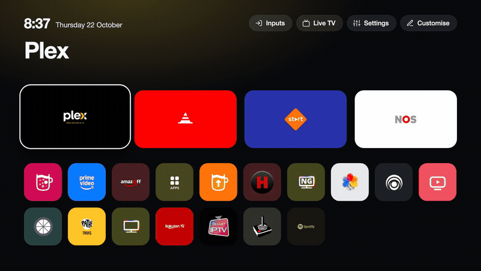
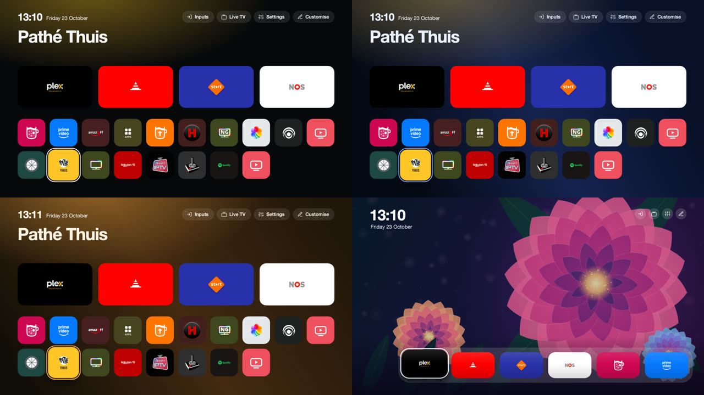

<p align="center"></p>

# CleanYourTV for LG webOS

A fast home screen for rooted LG webOS TVs, with Live TV from your own playlist, an Inputs list on the Input key,
picture notifications, optional on-device voice recognition and an optional debloat of LG's ads and telemetry.

> [!NOTE]
> **LG's system files are not modified.** The launcher takes over Home with a mount that exists only in RAM, so a reboot without the
> boot scripts brings LG's Home back. Everything we install is stored in `/media/developer/cleanyourtv` (plus two boot scripts and
> the key binds), and the uninstall removes it. It runs on the TV: no server and no account of ours, and the project collects no
> data. Optional features contact the services you choose; [Security](https://lasharor.github.io/cleanyourtv-WebOS/security/) lists them.

**CleanYourTV** replaces LG's Home with a launcher: a dock of four apps, a top shelf, an app grid sorted by use, an Inputs
picker, a Settings shortcut and a clock. A small service runs on the TV as root and adds the rest. A manager app on the TV
sets up, updates and removes everything.

<p align="center"></p>

### Compatibility at a glance

* **webOS**: 5 and newer (2020 models and later). webOS 4 and older have no systemd and an old Node.js; the setup stops before it
  changes anything. LG names its versions two ways: [webOS version numbers](https://lasharor.github.io/cleanyourtv-WebOS/tested-tvs/#webos-version-numbers) gives both.
* **Access**: a TV rooted with the [Homebrew Channel](https://webosbrew.org) ([rootmy.tv](https://rootmy.tv)), SSH as `root` for
  the install command, and internet access on the TV for the download.
* **Tested hardware**: LG OLED65G26LA on webOS 25. Other TVs are reported in
  [Tested TVs](https://lasharor.github.io/cleanyourtv-WebOS/tested-tvs/); an unlisted firmware is set up when LG's Home is of the
  flutter or web kind, and otherwise the setup stops and offers **Set up anyway**.

**[Read the documentation](https://lasharor.github.io/cleanyourtv-WebOS/)** for the features, installation, updates and security.

---

## Quick start

1. Root the TV and install the [Homebrew Channel](https://webosbrew.org).
2. From your computer, with your TV's IP address, install the manager app:

   ```sh
   ssh root@192.168.1.50 'curl -fsSL https://raw.githubusercontent.com/lasharor/cleanyourtv-WebOS/main/install.sh | sh'
   ```

3. On the TV, open **CleanYourTV**, choose the options and **Set up now**. It takes about a minute and the screen blinks once.

That's it. The launcher is LG's Home from then on. If the new Home does not come up, the setup removes the boot scripts and
restarts the TV with LG's Home. The [installation guide](https://lasharor.github.io/cleanyourtv-WebOS/install/) has the details
and troubleshooting.

---

## What it's for

1. **[A launcher that is quick and yours](https://lasharor.github.io/cleanyourtv-WebOS/launcher/).** A dock of four apps, an app
   grid sorted by how often you use each app, top buttons you choose, an Inputs list and a clock; menus in English, Dutch, German,
   French and Spanish; [themes](https://lasharor.github.io/cleanyourtv-WebOS/themes/) for colours, layout and wallpaper.

2. **[Live TV from your own playlist](https://lasharor.github.io/cleanyourtv-WebOS/live-tv/).** Plays an M3U playlist (HLS) with a
   channel list, a programme guide (XMLTV) and number entry. It does not use LG's tuner, and the project provides no channels.

3. **[An Inputs list on the Input key](https://lasharor.github.io/cleanyourtv-WebOS/input-key/).** The remote's Input button opens
   the dock apps, the HDMI inputs (with what is connected) and Live TV over the running app.

4. **[Picture notifications](https://lasharor.github.io/cleanyourtv-WebOS/notifications/).** A card with a photo over whatever is on
   screen, sent from your network with a POST request, for example from Home Assistant.

5. **[Voice, on the TV](https://lasharor.github.io/cleanyourtv-WebOS/voice/) (optional).** Speech recognition from the remote's
   microphone with a local model (Moonshine), answers from Home Assistant's Assist, a language model through OpenRouter or your own server, shown as
   text. No audio is recorded or sent anywhere.

6. **[Removing LG's ads and telemetry](https://lasharor.github.io/cleanyourtv-WebOS/debloat/) (optional).** Stops LG's ad and
   telemetry services and blocks a few ad servers, only while the launcher is Home, and undoes cleanly.

7. **[Setting up, updating and removing it from the TV](https://lasharor.github.io/cleanyourtv-WebOS/manager/).** The manager app
   checks every download against a SHA-256 file, rolls back a launcher or service that does not start, and can follow a
   [test build](https://lasharor.github.io/cleanyourtv-WebOS/managing/#test-builds) of a branch when you are asked to try a change.

---

## Themes

Pick how Home looks in the manager app: colours, the position and size of the clock, buttons, dock and grid, a wallpaper, animation
speed. Eight themes are bundled in [`themes/`](themes/); a theme is a small JSON file, so adding one is a pull request
([how](https://lasharor.github.io/cleanyourtv-WebOS/themes/#contributing-a-theme)).

<p align="center"><a href="themes/"></a></p>

---

## Screenshots

<p align="center">
  <a href="docs/screenshots/live.jpg"></a>
  &nbsp;
  <a href="docs/screenshots/picker.jpg"></a>
  <br>
  <a href="docs/screenshots/grid.jpg"></a>
  &nbsp;
  <a href="docs/screenshots/manager.jpg"></a>
  <br>
  <sub>Live TV guide, the Inputs picker, the app grid and the manager app.</sub>
</p>

[More screenshots](https://lasharor.github.io/cleanyourtv-WebOS/#screenshots).

---

## Documentation

* [Installing](https://lasharor.github.io/cleanyourtv-WebOS/install/) and [tested TVs](https://lasharor.github.io/cleanyourtv-WebOS/tested-tvs/)
* [Updating and uninstalling](https://lasharor.github.io/cleanyourtv-WebOS/managing/), including test builds
* Using it: [the launcher](https://lasharor.github.io/cleanyourtv-WebOS/launcher/), [Live TV](https://lasharor.github.io/cleanyourtv-WebOS/live-tv/),
  [the Input key](https://lasharor.github.io/cleanyourtv-WebOS/input-key/), [picture notifications](https://lasharor.github.io/cleanyourtv-WebOS/notifications/),
  [voice](https://lasharor.github.io/cleanyourtv-WebOS/voice/), [debloat](https://lasharor.github.io/cleanyourtv-WebOS/debloat/) and
  [the manager app](https://lasharor.github.io/cleanyourtv-WebOS/manager/)
* [Security](https://lasharor.github.io/cleanyourtv-WebOS/security/)
* [What it changes on the TV](https://lasharor.github.io/cleanyourtv-WebOS/tv-changes/)
* [Service API](https://lasharor.github.io/cleanyourtv-WebOS/api/) and [troubleshooting](https://lasharor.github.io/cleanyourtv-WebOS/troubleshooting/)
* [Contributing](https://lasharor.github.io/cleanyourtv-WebOS/development/), [testing and CI](https://lasharor.github.io/cleanyourtv-WebOS/development/testing/)
  and [internals](https://lasharor.github.io/cleanyourtv-WebOS/development/internals/)

The pages are built with [Zensical](https://zensical.org) from [docs/](docs/), so they can also be read there.

---

## Security

The service runs as root on the TV and listens on `127.0.0.1:8765` only. A few short-lived pages open on the local network on
request (Live TV pairing, share log, voice setup) and the notification endpoint is off until you switch it on. Everything it
installs comes from this repository's GitHub releases and carries a SHA-256 file, which detects corruption but **not a compromised
repository**: download only from this repository's release page. [Security](https://lasharor.github.io/cleanyourtv-WebOS/security/)
covers the ports, the token for notifications, voice and test builds. To report a vulnerability, see [SECURITY.md](SECURITY.md).

---

## Contributing

Reports from other TVs are the most useful contribution: open an [issue](https://github.com/lasharor/cleanyourtv-WebOS/issues)
with the output of **Share log** in the manager app. For code, see [Contributing](https://lasharor.github.io/cleanyourtv-WebOS/development/):
the service runs on Node.js 8 (webOS 5), `tools/node8-check.sh` checks that, and every branch push publishes a test build.

---

## Disclaimer

CleanYourTV is an independent project. It is not affiliated with, endorsed by or supported by LG Electronics. LG and webOS are
trademarks of LG Electronics. This modifies a running TV with root access; read `install.sh` and `scripts/` before running them,
and use it at your own risk. Live TV plays only the playlists you add.

## Licence

MIT. See `LICENSE`. The package also contains third-party files, listed with their licences in
[`THIRD-PARTY.md`](THIRD-PARTY.md) and in [Credits and licences](https://lasharor.github.io/cleanyourtv-WebOS/credits/). The home-screen
design follows the Android TV project [CleanYourTV](https://github.com/Gathin23/cleanyourtv) (MIT); no code from it is used.
