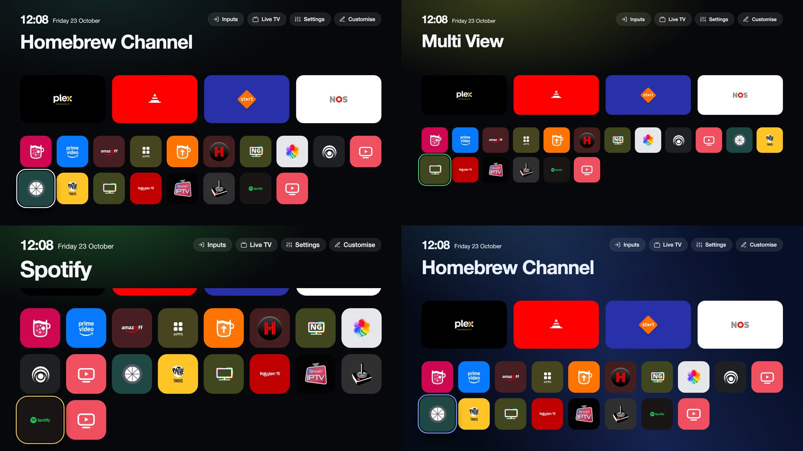
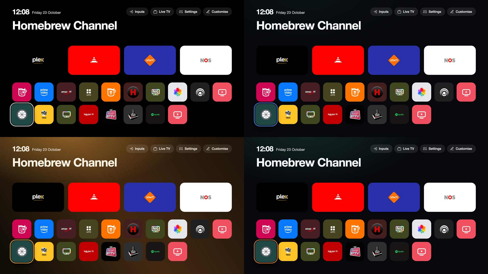
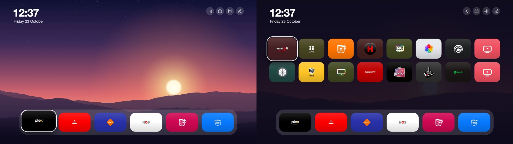

# Themes

A theme changes how the home screen looks: colours, the size of tiles and text, the number of columns, the clock, the ambient glow,
the speed of animations and a wallpaper. Themes apply to the launcher's home screen (dock, top shelf, grid, top buttons and menus).
Live TV, the Inputs picker and the notification cards keep their own look.

In the manager app, **Theme** lists the themes. Choosing one applies it; the home screen shows it the next time you open Home.
**Accent colour** changes the colour of the focus ring and of the highlighted button or menu row on top of any theme.
**Go back to the previous theme** undoes the last change.

## Bundled themes

| Theme | What it is |
|---|---|
| Classic | The original look: near-black, white focus, ten columns. The default. |
| Midnight | Deep blue with a wallpaper and a blue focus. |
| OLED black | Pure black and no ambient glow, so unlit pixels stay off. |
| Warm | Brown and amber, with the glow in the accent colour and a wallpaper. |
| Compact | Twelve columns of smaller tiles: more apps on screen. |
| Large print | Eight columns of big tiles and larger text. |
| Still | No animation and a quiet glow. |
| Sunset | A wallpaper with the dock at the bottom in a glass panel, six dock apps, round buttons and a stacked clock. Down from the dock opens all apps over the wallpaper; Back closes them. |







The pictures are the launcher page rendered in a browser with each theme.

## Theme files

A theme is a JSON file in `helper/themes/` of this repository, shipped with the service. To contribute one, add
`helper/themes/<id>.json` (and a wallpaper in `helper/themes/wallpapers/` if it uses one) in a pull request. Every key is optional.
A missing or invalid value keeps the value of the theme named in `"extends"`, or the default, which is the original look, so a
theme lists only what it changes. Positions and sizes are in pixels on a 1920 x 1080 canvas.

```json
{
  "name": "Midnight",
  "author": "CleanYourTV",
  "description": "Deep blue with a soft wallpaper and a blue focus.",
  "extends": "classic",
  "colors": { "night": "#060a18", "panel": "#101830", "ink": "#eaf0ff", "accent": "#7aa2ff" },
  "effects": { "glow": 0.8, "wallpaper": "midnight.jpg", "wallpaperDim": 0.25 }
}
```

### What a theme can set

Every part of the home screen has its own position and size, so themes can arrange the screen differently, not only recolour it:
the **clock**, the top **buttons** (`bar`), the large app **name**, the **dock** and the **grid**. Each can be anchored to the top
or bottom edge and aligned left, centre or right, with an offset. A dock at the bottom turns the grid into an overlay that opens
when the focus moves down into it (Back or Up closes it); a dock at the top leaves the grid below it, scrolling.

<!-- schema:start -->
| Key | Values | Default | |
|---|---|---|---|
| **colors** | | | |
| `colors.night` | `#rrggbb` | `#07080b` | Page background. |
| `colors.panel` | `#rrggbb` | `#14161b` | Toast background; menu rows are a lighter mix of it. |
| `colors.ink` | `#rrggbb` | `#f5f6f8` | Text. |
| `colors.accent` | `#rrggbb` | `#f5f6f8` | Highlight: the focused button and menu row and, unless `colors.focus` is set, the focus ring. |
| `colors.focus` | `#rrggbb` or empty | empty | Focus ring colour; empty uses the accent. |
| `colors.pill` | `#rrggbb` | `#ffffff` | Colour of the translucent top buttons, with `surface.pillAlpha`. |
| **surface** | | | |
| `surface.pillAlpha` | 0 to 0.6 | `0.09` | Opacity of the top buttons. |
| `surface.pillRing` | 0 to 0.8 | `0.1` | Opacity of the thin outline of the top buttons. |
| `surface.pillRadius` | 0 to 60 | `32` | Corner radius of the top buttons (pill style only). |
| `surface.menuAlpha` | 0.5 to 1 | `0.97` | Opacity of the dark layer behind menus. |
| `surface.rowRadius` | 0 to 50 | `30` | Corner radius of menu rows. |
| **type** | | | |
| `type.font` | `default`, `serif`, `mono` | `default` | The typeface: the TV's own, a serif or a monospace. |
| `type.scale` | 0.8 to 1.3 | `1` | Scale of the text of buttons, menus and tiles. |
| **clock** | | | |
| `clock.show` | `true` or `false` | `true` | Show the clock. |
| `clock.date` | `true` or `false` | `true` | Show the date beside or under the time. |
| `clock.layout` | `inline`, `stack` | `inline` | `inline`: the date beside the time; `stack`: under it. |
| `clock.anchor` | `top`, `bottom` | `top` | Which screen edge `clock.y` counts from. |
| `clock.align` | `left`, `center`, `right` | `left` | Which side `clock.x` counts from; `center` centres it. |
| `clock.x` | 0 to 900 | `96` | Distance from that side, in px (on a 1920 x 1080 canvas). |
| `clock.y` | 0 to 900 | `54` | Distance from the top or bottom edge, in px. |
| `clock.scale` | 0.6 to 2.5 | `1` | Scale of the time. |
| `clock.dateScale` | 0.6 to 2 | `1` | Scale of the date. |
| **bar** | | | |
| `bar.show` | `true` or `false` | `true` | Show the top buttons (Inputs, Settings, Customise, ...). |
| `bar.style` | `pill`, `round`, `flat` | `pill` | `pill`: icon and label on a rounded button; `round`: icon only in a circle; `flat`: no background. |
| `bar.labels` | `auto`, `show`, `hide` | `auto` | Button labels: `auto` shows them except in the `round` style. |
| `bar.anchor` | `top`, `bottom` | `top` | Which screen edge `bar.y` counts from. |
| `bar.align` | `left`, `center`, `right` | `right` | Which side `bar.x` counts from. |
| `bar.x` | 0 to 900 | `96` | Distance from that side, in px. |
| `bar.y` | 0 to 900 | `54` | Distance from the top or bottom edge, in px. |
| `bar.size` | 40 to 100 | `64` | Height of a button, in px. |
| `bar.gap` | 4 to 40 | `16` | Space between buttons, in px. |
| **name** | | | |
| `name.show` | `true` or `false` | `true` | Show the large name of the focused app. |
| `name.align` | `left`, `center`, `right` | `left` | Text alignment of the name. |
| `name.x` | 0 to 900 | `96` | Margin on both sides, in px. |
| `name.y` | 0 to 900 | `150` | Distance from the top edge, in px. |
| `name.scale` | 0.4 to 1.6 | `1` | Scale of the name. |
| **dock** | | | |
| `dock.anchor` | `top`, `bottom` | `top` | Which screen edge `dock.y` counts from. A dock at the bottom makes the grid an overlay. |
| `dock.align` | `left`, `center`, `right` | `left` | Which side `dock.x` counts from; `center` centres the dock. |
| `dock.x` | 0 to 900 | `96` | Distance from that side, in px. |
| `dock.y` | px, 0 to 1000 | empty | Distance from the top or bottom edge, in px. Empty: 360 from the top, 68 from the bottom. |
| `dock.count` | 3 to 8 | `4` | Apps in the dock. |
| `dock.w` | 120 to 500 | `408` | Width of a dock tile, in px. |
| `dock.h` | 100 to 300 | `230` | Height of a dock tile, in px. |
| `dock.gap` | 8 to 60 | `32` | Space between dock tiles, in px. |
| `dock.radius` | 0 to 80 | `36` | Corner radius of dock tiles. |
| `dock.panel` | 0 to 0.6 | `0` | Opacity of a translucent panel behind the dock tiles; 0 for none. |
| `dock.panelPad` | 0 to 60 | `24` | Space between the panel and the tiles, in px. |
| `dock.lift` | 0 to 40 | `10` | How far the focused dock tile rises, in px. |
| `dock.focusScale` | 1 to 1.3 | `1.05` | Scale of the focused dock tile. |
| **grid** | | | |
| `grid.mode` | `below`, `overlay` | `below` | `below`: the grid sits under the dock and scrolls; `overlay`: it opens over the screen when the focus moves down into it. Forced to `overlay` for a dock at the bottom. |
| `grid.cols` | 4 to 14 | `10` | Columns. |
| `grid.tileH` | 80 to 240 | `151` | Height of a tile, in px; the width follows from the columns. |
| `grid.gapX` | 6 to 60 | `24` | Horizontal space between tiles, in px. |
| `grid.gapY` | 6 to 60 | `26` | Vertical space between tiles, in px. |
| `grid.radius` | 0 to 100 | `34` | Corner radius of tiles. |
| `grid.x` | 0 to 900 | `96` | Distance of the grid from the left edge, in px. |
| `grid.width` | 600 to 1920 | `1728` | Width of the grid, in px. |
| `grid.y` | px, 0 to 1000 | empty | Distance of the grid from the top edge, in px. Empty: under the dock, or 290 for an overlay. |
| `grid.clipTop` | 0 to 600 | `300` | Where scrolled rows disappear at the top, in px (`below` mode). |
| `grid.focusScale` | 1 to 1.4 | `1.12` | Scale of the focused tile. |
| `grid.overlayDim` | 0 to 1 | `0.95` | Opacity of the layer behind the overlay grid. |
| `grid.overlayH` | 200 to 900 | `510` | Visible height of the overlay grid before it scrolls, in px. |
| **tile** | | | |
| `tile.gloss` | 0 to 1 | `0` | A light highlight on every tile. |
| `tile.border` | 0 to 0.6 | `0` | Opacity of a thin outline on every tile. |
| `tile.ringWidth` | 0 to 10 | `4` | Width of the focus ring, in px; 0 for none. |
| `tile.ringOffset` | 0 to 14 | `4` | Space between a tile and its focus ring, in px. |
| **effects** | | | |
| `effects.glow` | 0 to 1 | `1` | Strength of the ambient glow at the top. |
| `effects.glowColor` | `app`, `accent` | `app` | `app`: taken from the focused icon; `accent`: the accent colour. |
| `effects.speed` | 0 to 2 | `1` | Animation speed multiplier; 0 switches the animations off. |
| `effects.wallpaper` | a file name | none | A file name in `helper/themes/wallpapers/`: `.jpg`, `.png` or `.webp`, at most 1.5 MB; drawn at 1920 x 1080. |
| `effects.wallpaperDim` | 0 to 0.9 | `0.4` | How far the wallpaper is darkened with the background colour. |
<!-- schema:end -->

A theme file holds values only. The service checks every value against the table and clamps numbers to their range; there is no CSS
and no script, and a wallpaper path is accepted only as a plain file name from the bundled folder that is also a real image of the
right type. Anything else is ignored. The launcher draws the wallpaper once and nothing blurs or filters it, because the TV's GPU is weak.

From a shell on the TV:

```sh
curl localhost:8765/api/theme/list
curl -X POST localhost:8765/api/theme/set -d '{"id":"midnight","accent":"#ff8a3d"}'
curl -X POST localhost:8765/api/theme/revert
```
