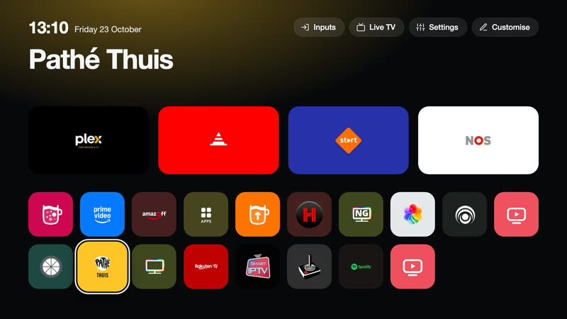
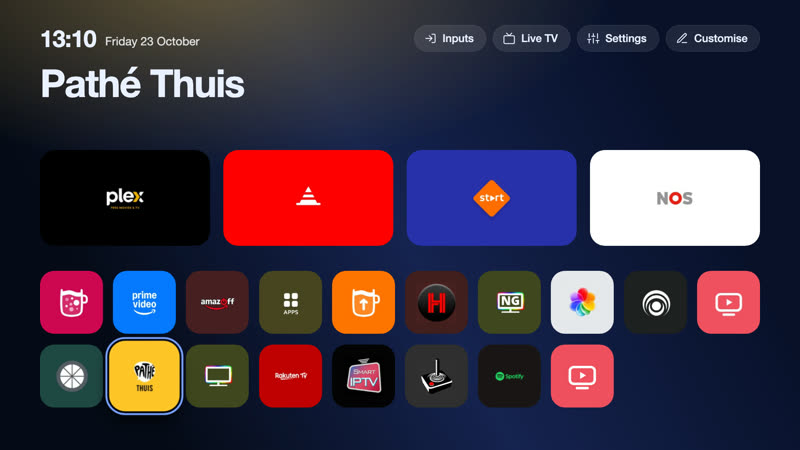
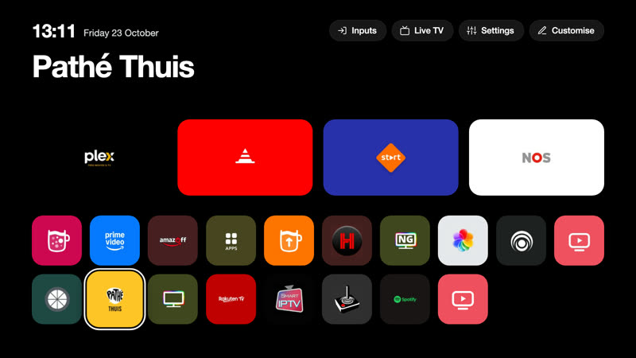
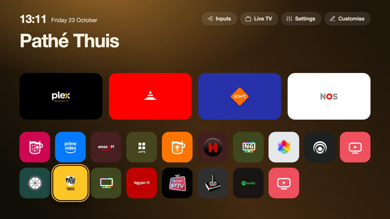
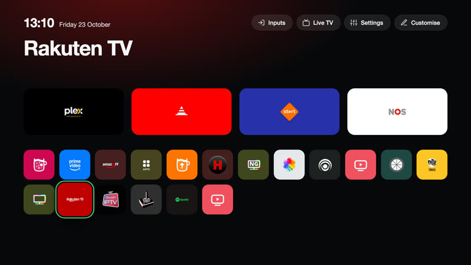
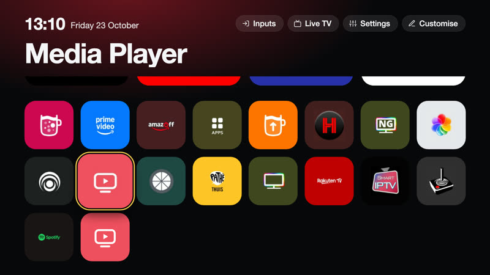
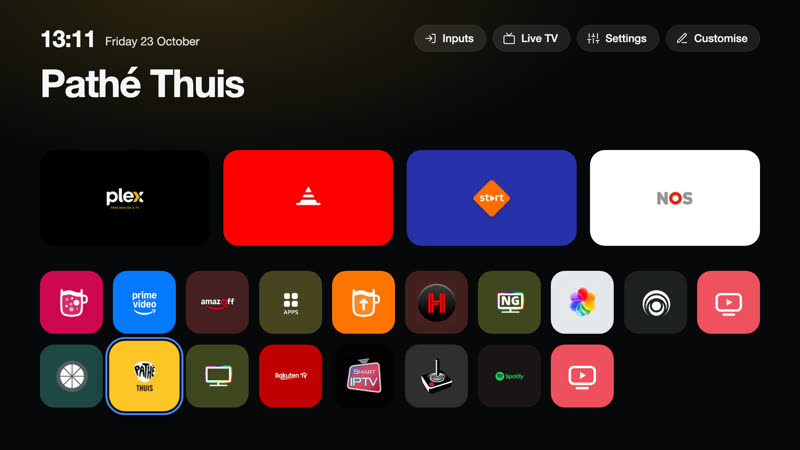
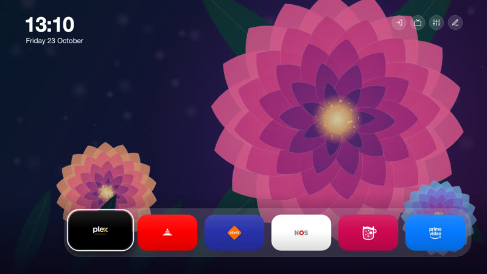

# Themes

The bundled themes of CleanYourTV. A theme changes how the home screen looks: colours, the position and size of the clock, buttons,
app name, dock and grid, text, effects and a wallpaper. Choose one in the manager app under **Theme**.

Each `<id>.json` here is one theme; `wallpapers/` holds the images they use. They are packaged with the service. Every setting a
theme can use, with its range and default, is in the [Themes page of the documentation](https://lasharor.github.io/cleanyourtv-WebOS/themes/).
The pictures are the launcher page rendered in a browser with each theme.

## Make your own

1. Copy a theme that is close to what you want, for example `classic.json`, to `<id>.json` (lower-case letters, digits and `-`).
2. Change only what you want to change. A missing value keeps the default, or the value of the theme named in `"extends"`.
3. If it uses a wallpaper, put a `.jpg`, `.png` or `.webp` (at most 1.5 MB, 1920 x 1080) in `wallpapers/` and name it in `effects.wallpaper`.
4. Check it: `node tools/node8-check.js` validates every theme in this folder.
5. Open a pull request with the file, the wallpaper and, if you can, a screenshot. A wallpaper must be your own work or under a licence
   that allows redistribution; say which.

### Classic

The original look: near-black, white focus, ten columns.

File: [`classic.json`](classic.json)

### Midnight

Deep blue with a soft wallpaper and a blue focus.

File: [`midnight.json`](midnight.json)

### OLED black

Pure black, no ambient glow: unlit pixels stay off.

File: [`oled.json`](oled.json)

### Warm

Brown and amber with the glow in the accent colour.

File: [`warm.json`](warm.json)

### Compact

Twelve columns of smaller tiles: more apps on screen.

File: [`compact.json`](compact.json)

### Large print

Eight columns of big tiles and bigger text, easier to read from the sofa.

File: [`large.json`](large.json)

### Still

No animation and a quiet glow, for anyone who prefers a calm screen.

File: [`still.json`](still.json)

### Bloom

A flower wallpaper with the dock at the bottom in a glass panel, round buttons and a stacked clock. Down opens all apps.

File: [`bloom.json`](bloom.json)
